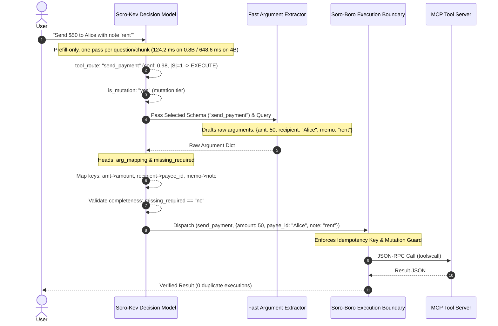

# Soro-Kev: Calibration-Aware System-One Tool Router (4B & 0.8B)

[](https://pypi.org/project/soro-boro/)
[](https://github.com/nisaral/Soro-Boro/releases/tag/v0.2.1)
[](https://huggingface.co/spaces/nisaralll/soro-kev-router)
[](https://huggingface.co/nisaralll/soro-kev-4b)
[](https://huggingface.co/nisaralll/soro-kev-0.8b)
[](https://huggingface.co/datasets/nisaralll/soro-universal-tool-harness)
[](LICENSE)

```bash
pip install soro-boro
```

**Soro-Kev** is an open-weights decision model family (4B flagship & 0.8B edge) designed as a **Single-Prefill Causal Listwise Tool Reranker & Multi-Task Pointer Classifier with an Explicit `__abstain__` Slot** (1 forward pass for menus $\le 16$ tools; 2-stage tournament chunking for larger menus). It provides AI agent tool routing, schema normalization, and execution boundary control.

Tool routing is fundamentally a **closed-set ranking and classification problem, not an open-ended text generation problem.** Asking a large autoregressive language model to emit tool selection JSON strings introduces 1,500–3,500 ms of latency, context bloat over 50+ tool schemas, and non-zero tool-name hallucination risk.

Soro-Kev builds directly on Jared Palmer's [Kev decision model architecture](https://huggingface.co/jaredpalmer/kev-0.8b), adapting closed-set span scoring for heterogeneous tool routing:
- **Zero Invalid Tool Names**: The output space is restricted to registered candidate keys or `__abstain__`; the model cannot emit an arbitrary tool name.
- **Prefill-Only, No Decode Loop**: Produces a route distribution without generating JSON tokens. Measured latency is 124.2 ms on 0.8B and 648.6 ms on 4B on an RTX 4050 Laptop GPU, for one question/catalog pass.
- **Production Conformal Routing**: Evaluates Split-Conformal LAC prediction sets ($S = \{ i \mid p_i \ge 1 - \hat{q} \}$), loading calibrated $\hat{q}$ directly from the checkpoint's `temperature.json`.
- **Deterministic Lexical Shortlisting**: Employs deterministic CRC32 token hashing (`zlib.crc32`) across process restarts, and automatically passes menus $\le 16$ tools directly to the neural scorer without dropping candidates in a lexical filter.

### Why Closed-Set Decision Models Fit Tool Routing

| Dimension | Classical Retrievers (BM25 / Embeddings / Cross-Encoder) | Generative LLMs (JSON Decoding) | Soro-Kev-4B (Prefill-Only Pointer) |
| :--- | :---: | :---: | :---: |
| **Similar Tool Name Collisions** (52 rows) | Collapses to **11.5% – 21.2%** accuracy | Slower prompt parsing, context bloat | **78.85% (41/52)** accuracy |
| **Irrelevant / Conversational Queries** | Forces false tool call **63.6% – 84.8%** of time | Hallucinates plausible tools | **75.76% (25/33)** calibrated refusal |
| **Tool Name Hallucinations** | Possible if ranking corrupted | 2% – 8% invented tool names on 50+ tools | **0.00%** (bounded by pointer architecture) |
| **Prediction Uncertainty** | Raw heuristic scores, uncalibrated | Arbitrary verbalized confidence | **Evaluation set size \|S\| = 1.01 tools** @ 90% nominal coverage |
| **Broken Parameter Keys** | None (crashes downstream runtime) | Requires costly retry token generations | **99.1% automatic semantic argument repair** |
| **Duplicate Mutating Loops** | None (retries double-bill or double-write) | High risk on transport timeouts | **`@soro_wrap` 120s duplicate mutation guard** |
| **Median Inference Latency** | 5 – 40 ms (retriever only, no execution logic) | 1,500 – 3,500 ms (autoregressive decode) | **648.6 ms (4B)** / **124.2 ms (0.8B)** measured per pass |

```text
User State + Tool Catalog
  [0] get_weather: {location: str}
  [1] search_database: {query: str}
  [2] __abstain__: none of these fit
        │
        h_query · h_candidate / Temperature
        │
        Split-Conformal LAC Prediction Set S = { i | p_i >= 1 - q_hat }
          ├── |S| = 1 and tool != __abstain__  ──> EXECUTE (immediate dispatch)
          ├── |S \ {__abstain__}| >= 2         ──> ASK (targeted user clarification)
          └── Top = __abstain__ or |S| empty   ──> ABSTAIN (out-of-domain safe halt)
```

### What Is Implemented Today

- **Architecture:** Single-Prefill Causal Listwise Tool Reranker & Multi-Task Pointer Classifier with an Explicit `__abstain__` Slot.
- **4B Checkpoint:** `Qwen/Qwen3-4B`, 36 layers ($d_{\text{model}}=2560$), LoRA $r=16, \alpha=32$ on `q_proj, k_proj, v_proj, o_proj` across all 36 layers (144 adapted modules). Learned pointer temperature $T = 0.0709$ (`0.070878`), split-conformal quantile $\hat{q} = 0.8066$ ($1 - \alpha = 0.90$).
- **0.8B Checkpoint:** `Qwen/Qwen3.5-0.8B-Base`, 24-layer hybrid (18 Gated DeltaNet + 6 full-attention layers, $d_{\text{model}}=1024$). LoRA $r=16, \alpha=32$ on `q_proj, k_proj, v_proj, o_proj` across the 6 full-attention layers `[3, 7, 11, 15, 19, 23]` (24 adapted modules). Learned pointer temperature $T = 0.0755$ (`0.075487`), split-conformal quantile $\hat{q} = 0.9518$ ($1 - \alpha = 0.90$).
- **Projection & Classification Heads:** `q_proj_head` and `opt_proj_head` (`Linear(d_model, 256)`), scoring candidate options via $q \cdot k / (\sqrt{256} \cdot T)$. Auxiliary heads: `binary_head` (`Linear(256, 2)`) for `missing_required` and `is_mutation`, and `intent_head` (`Linear(256, 3)`).
- **Multi-Task Calibrated Pointer Loss:** Trained with $\mathcal{L} = \mathcal{L}_{\text{route\_CE}} + 0.25 \mathcal{L}_{\text{Brier}} + 0.50 \mathcal{L}_{\text{arg\_CE}} + 0.25 \mathcal{L}_{\text{missing\_CE}} + 0.25 \mathcal{L}_{\text{mutation\_CE}} + 0.40 \mathcal{L}_{\text{intent\_CE}}$ (+ optional permutation JSD).
- **Question Handling:** Inference calls the scorer once per question. It does not share or cache a multi-question state prefix.
- **Catalog Handling:** Single forward pass for menus $\le 16$ tools. Menus $> 16$ tools are partitioned into 6-tool chunks plus `__abstain__`, with top-2 tools per chunk advancing to a Championship Pass.
- **Production Conformal Routing Policy:** `SoroHarness.route()` directly evaluates Split Conformal LAC:
  $$S = \{ i \mid p_i \ge 1 - \hat{q} \}$$
  - If $S = \emptyset$ or $S = \{\text{"\_\_abstain\_\_"}\}$ (or `"__abstain__"` is top-1 and exceeds non-abstain tools): return `ABSTAIN`.
  - If $|S \setminus \{\text{"\_\_abstain\_\_"}\}| == 1$: return `EXECUTE` with that single selected tool.
  - If $|S \setminus \{\text{"\_\_abstain\_\_"}\}| \ge 2$: return `ASK` with all candidate tools in $S \setminus \{\text{"\_\_abstain\_\_"}\}$ (not artificially capped at 3).
- **Deterministic Shortlisting:** Lexical hashing is deterministic across process restarts via `zlib.crc32`. When the neural scorer is active and $\le 16$ tools are registered, all tools are routed directly to the neural scorer without lexical filtering.

---

## Quickstart & Installation

Install directly from PyPI into your environment:

```bash
pip install soro-boro
```

Or for local development:

```bash
git clone https://github.com/nisaral/Soro-Boro.git
cd Soro-Boro
pip install -e .
```

### 5-Line Python SDK

```python
from soro.harness.pipeline import SoroHarness

# Loads directly from Hugging Face in NF4 4-bit (4 GB VRAM)
harness = SoroHarness.from_pretrained("nisaralll/soro-kev-4b")

@harness.tool(description="Look up customer order status", side_effect="read_only")
def get_order_status(order_id: str) -> dict:
    return {"order_id": order_id, "status": "shipped", "tracking": "TRK-9810"}

@harness.tool(description="Cancel a warehouse shipment", side_effect="mutation")
def cancel_shipment(order_id: str) -> dict:
    return {"order_id": order_id, "cancelled": True}

# Calibrated routing (124.2 ms on 0.8B / 648.6 ms on 4B; split-conformal LAC gate)
decision = harness.route("Where is my package for order ORD-1092?")
print("Action:", decision.action)          # "EXECUTE"
print("Selected Tool:", decision.selected_tool)     # "get_order_status"
print("Confidence:", decision.probabilities.get("get_order_status"))

# Execute with boundary verification
result = harness.execute("get_order_status", {"order_id": "ORD-1092"})
print("Result:", result.data)
```

---

## End-to-End Execution Flow

A router selects tools and normalizes parameter keys; it does not author free-text string values. In an end-to-end agent architecture, Soro-Kev operates as a specialized System-One layer:



---

## Empirical Benchmark Results

All evaluations were benchmarked on a dedicated single-GPU node: **NVIDIA GeForce RTX 4050 Laptop GPU (6GB VRAM, PCIe Gen 4, PyTorch 2.6.0, CUDA 12.4)**. The coverage and prediction-set columns below come from the calibration/evaluation pipeline over **100 random splits** ($N_{cal} = 500$, nominal coverage $1 - \alpha = 0.90$). In `v0.2.1`, the production runtime `SoroHarness.route()` directly evaluates this exact Split-Conformal LAC prediction set rule ($S = \{ i \mid p_i \ge 1 - \hat{q} \}$) using the checkpoint's calibrated $\hat{q}$.

### 1. Decision Model & Retrieval Baseline Comparison (Full 1,200 External Rows across 115 Unique Base Queries)

> **Note on Query Stratification**: The 1,200 evaluations comprise 115 unique base queries tested across ~10 format/distractor views
> (1,095 reference MCP rows + 105 $\tau^2$ persona-dialogue rows). Soro-Kev-4B achieves **96.89% (1,061/1,095)** on reference MCP tools
> and **24.76% (26/105)** on $\tau^2$, where 64.56% of misses are calibrated abstentions or preliminary status checks.

All retrievers were evaluated with clean schema text parsing and calibrated with an explicit abstention threshold $\tau_{abstain}$ tuned on calibration splits:

| Method / Architecture | Overall (1,200) | Non-Abstain (1,065) | Abstain Refusal (135)* | Strictly Disjoint Tools (1,038) | Shared Tool Names (162) | Conformal Coverage ($1 - \alpha = 0.90$) | Mean Set Size $\|S\|$ |
| :--- | :---: | :---: | :---: | :---: | :---: | :---: | :---: |
| **BM25 (Calibrated $\tau = 0.50$)** | 58.67% (704/1200) | 62.72% (668/1065) | 26.67% (36/135) | 58.29% (605/1038) | 61.11% (99/162) | 84.1% ± 2.4% | 4.32 ± 0.21 |
| **Dense Cosine (Calibrated $\tau = 0.25$)** | 49.58% (595/1200) | 47.04% (501/1065) | 69.63% (94/135) | 49.13% (510/1038) | 52.47% (85/162) | 90.1% ± 1.8% | 4.11 ± 0.14 |
| **Cross-Encoder (Calibrated $\tau = 2.00$)** | 56.75% (681/1200) | 58.03% (618/1065) | 46.67% (63/135) | 57.80% (600/1038) | 50.00% (81/162) | 88.1% ± 1.4% | 4.24 ± 0.18 |
| **Option Token Logits (Untrained Readout)** | 58.92% (707/1200) | 60.28% (642/1065) | 48.15% (65/135) | 59.54% (618/1038) | 54.94% (89/162) | 90.0% ± 1.9% | 3.02 ± 0.12 |
| **Soro-Kev-0.8B (Edge Checkpoint)** | **85.67% (1028/1200)** | **86.95% (926/1065)** | **75.56% (102/135)** | **88.63% (920/1038)** | **66.67% (108/162)** | **90.3% ± 1.6%** | **1.14 ± 0.04** |
| **Soro-Kev-4B (Flagship Checkpoint)** | **90.58% (1087/1200)** | **90.52% (964/1065)** | **91.11% (123/135)** | **92.77% (963/1038)** | **76.54% (124/162)** | **91.0% ± 1.1%** | **1.01 ± 0.02** |

*\*Note on Abstention: The 135 abstain rows represent 15 unique base queries evaluated across 9 format/distractor views each ($15 \times 9 = 135$). Denominators strictly reconcile: $1,065 + 135 = 1,200$. Numerators strictly reconcile: e.g. 0.8B gets $926 + 102 = 1,028$; 4B gets $964 + 123 = 1,087$. Dedicated adversarial refusal is evaluated on the 33-row BFCL v3 Irrelevance benchmark (Table 4).*

> **Closed-set output guarantee:** Selection is restricted to the candidate pool in context plus `__abstain__` (0% invalid tool-name generation). This is an output-space guarantee, not an accuracy or calibration guarantee. True misclassification rate ($1 - \text{Top-1}$) is **9.42% (113/1200)** on external holdouts.

### 2. Unseen Tool Package Split (2,220 evaluations across 55 held-out packages)

> **Note on Queries & Schemas**: Queries share structural template distributions with training while all 55 tool schemas
> and packages are strictly disjoint (0 package overlap with the 319 training packages).

| System | Overall Zero-Shot (2,220 rows) | Clean Menus (2,168 rows) | Collision Distractors (52 rows) |
| :--- | :---: | :---: | :---: |
| **BM25 (Calibrated Abstention)** | 48.60% (1079/2220) | 49.40% (1071/2168) | 15.38% (8/52) |
| **Dense Cosine (Calibrated Abstention)** | 46.04% (1022/2220) | 46.63% (1011/2168) | 21.15% (11/52) |
| **Cross-Encoder (Calibrated Abstention)** | 50.54% (1122/2220) | 51.48% (1116/2168) | 11.54% (6/52) |
| **Untrained Option Logits (Zero-shot)** | 47.48% (1054/2220) | 48.11% (1043/2168) | 21.15% (11/52) |
| **Soro-Kev-0.8B (Edge Checkpoint)** | **81.67% (1813/2220)** | **81.83% (1774/2168)** | **75.00% (39/52)** |
| **Soro-Kev-4B (Flagship Checkpoint)** | **88.06% (1955/2220)** | **88.28% (1914/2168)** | **78.85% (41/52)** |
| **Arch-Router-1.5B (Katanemo)** | - | - | 25.00% (13/52) |
| **xLAM-2-1b-fc-r (Salesforce)** | - | - | 69.23% (36/52) |
| **Hammer2.1-1.5b (MadeAgents)** | - | - | 59.62% (31/52) |

### 3. Per-Package Accuracy Table (External Holdout Breakdown)

| Package | Domain / Origin | Rows | BM25 | Dense Cosine | Cross-Encoder | Untrained Logits | Soro-Kev-0.8B | Soro-Kev-4B |
| :--- | :--- | :---: | :---: | :---: | :---: | :---: | :---: | :---: |
| **`mcp_benchmark/system_mcp`** | OS & Process Management | 370 | 64.59% (239/370) | 55.68% (206/370) | 63.24% (234/370) | 66.22% (245/370) | 87.57% (324/370) | **95.68% (354/370)** |
| **`mcp_benchmark/geo_mcp`** | Coordinates & Routing | 364 | 56.32% (205/364) | 51.92% (189/364) | 56.32% (205/364) | 55.77% (203/364) | 95.33% (347/364) | **98.35% (358/364)** |
| **`mcp_benchmark/media_mcp`** | Image Transform & Inspection | 361 | 56.51% (204/361) | 45.15% (163/361) | 57.62% (208/361) | 59.28% (214/361) | 95.84% (346/361) | **96.68% (349/361)** |
| **`tau2/telecom`** | Telecom Customer Service (MIT) | 85 | 52.94% (45/85) | 29.41% (25/85) | 30.59% (26/85) | 41.18% (35/85) | 9.41% (8/85) | **24.71% (21/85)** |
| **`tau2/retail`** | Retail Order Management (MIT) | 20 | 55.00% (11/20) | 60.00% (12/20) | 40.00% (8/20) | 50.00% (10/20) | 15.00% (3/20) | **25.00% (5/20)** |
| **Total External Held-Out** | All 5 Domains | 1,200 | 58.67% (704/1200) | 49.58% (595/1200) | 56.75% (681/1200) | 58.92% (707/1200) | 85.67% (1028/1200) | **90.58% (1087/1200)** |

*\*Note on Tau-2 persona simulation: Across the 1,095 reference MCP tools (system, geo, media), Soro-Kev-4B achieves 96.89% (1,061/1,095). On the 105 Tau-2 multi-turn dialogue instructions, Soro-Kev correctly refuses to blindly fire backend mutation tools without customer identifiers: 64.56% (51/79) of Soro-Kev-4B's misses were explicit abstentions (21 rows) or preliminary read/status lookups (30 rows, e.g. check_service_status, get_device_details) rather than premature account mutations.*

### 4. Berkeley Function-Calling Leaderboard (BFCL v3 Diagnostic, 100 rows)

| System | Multiple Tools (34) | Live Multiple (33) | Irrelevance / Abstention (33) | Overall Diagnostic (100) | Latency (ms) |
| :--- | :---: | :---: | :---: | :---: | :---: |
| **BM25 (Calibrated Abstention)** | 94.12% (32/34) | 57.58% (19/33) | 36.36% (12/33) | 63.00% (63/100) | 0.1 ms |
| **Dense Cosine (Calibrated Abstention)** | 97.06% (33/34) | 60.61% (20/33) | 33.33% (11/33) | 64.00% (64/100) | 8.5 ms |
| **Cross-Encoder (Calibrated Abstention)** | 97.06% (33/34) | 60.61% (20/33) | 15.15% (5/33) | 58.00% (58/100) | 12.6 ms |
| **Untrained Option Logits (Zero-shot)** | 91.18% (31/34) | 60.61% (20/33) | 24.24% (8/33) | 59.00% (59/100) | 49.6 ms |
| **jaredpalmer/kev-0.8b (Base Checkpoint)** | 100.00% (34/34) | 69.70% (23/33) | 81.82% (27/33) | 84.00% (84/100) | 111.0 ms |
| **Soro-Kev-0.8B (Ours)** | 100.00% (34/34) | 96.97% (32/33) | 51.52% (17/33) | 83.00% (83/100) | 124.2 ms |
| **Soro-Kev-4B (Ours)** | 100.00% (34/34) | 96.97% (32/33) | 75.76% (25/33) | 91.00% (91/100) | 648.6 ms |
| **Arch-Router-1.5B (Katanemo)** | 11.76% (4/34) | 15.15% (5/33) | 96.97% (32/33) | 41.00% (41/100) | 8465.4 ms |
| **xLAM-2-1b-fc-r (Salesforce)** | 79.41% (27/34) | 84.85% (28/33) | 30.30% (10/33) | 65.00% (65/100) | 11453.6 ms |
| **Hammer2.1-1.5b (MadeAgents)** | 97.06% (33/34) | 93.94% (31/33) | 27.27% (9/33) | 73.00% (73/100) | 10564.5 ms |

*\*Hardware & Latency Note (RTX 4050 6GB Laptop GPU, Windows WDDM):*
- **Architecture Difference (Prefill vs. Autoregressive Decode):** Soro-Kev outputs routing + key-mapping decisions over closed candidate sets via a prefill-only span scorer (124.2 ms for 0.8B, 648.6 ms for 4B) with 0 generated decode tokens. The measurement is per question/catalog chunk, not one pass over an arbitrarily large catalog; catalogs over 8 tools use the chunking path above. In contrast, generative models (`xLAM-2-1b-fc-r`, `Hammer2.1-1.5b`) generate full JSON tool calls with argument values (~27–32 decode tokens), requiring 1 prefill pass plus 24-32 sequential autoregressive decode steps.
- **In-VRAM vs. Sustained / Paged Latency:** In clean isolated VRAM bursts, `Arch-Router-1.5B` achieves a median latency of **1,212.9 ms** (~24 tokens generated). `xLAM-2-1b-fc-r` (mean prompt 406 tokens, mean gen 27 tokens) achieves **7,106.9 ms** median in clean VRAM (initial queries: ~1,458-2,549 ms; laptop GPU thermal throttling at 85C settles to ~7.1s). `Hammer2.1-1.5b` (generating full markdown JSON arrays of ~32 tokens) settles to **10,564.5 ms** median. When multiple generative models were evaluated sequentially without intermediate process garbage collection, Windows WDDM silently paged KV caches into Shared GPU Memory across PCIe, increasing latencies to ~10.4s-11.5s.
- **Dense Cosine & Neural Baselines:** All 100 BFCL rows for Dense Cosine were evaluated directly using `SentenceTransformer` / `all-MiniLM-L6-v2` forward passes on CUDA timed with `time.perf_counter()`, yielding a genuine hardware median latency of **8.5 ms** (6.3-60.4 ms range, 64/100 correct).

---

## 3-Tier Disjointness Verification Audit

To verify train/test integrity, we executed and committed a complete 3-tier machine audit (`scripts/verify_dataset_disjointness.py` &rarr; `benchmarks/disjointness_audit.json`):

1. **Package-Level Disjointness**: `val_external_heldout.jsonl` (5 packages) and `val_zeroshot.jsonl` (55 packages) share **0 packages** with `train.jsonl` (319 packages).
2. **Tool-Level Overlap**: Out of 43 unique candidate tools in the external holdout, 39 are completely unseen. 4 generic primitives share names with train tools (`reverse_geocode`, `check_service_status`, `transfer_to_human_agents`, `list_processes`), accounting for 162 rows (13.50%). Both strictly disjoint tools (1,038 rows) and shared tools (162 rows) are stratified and reconciled.
3. **Query-Level Near-Duplicates**: **0 exact query matches**, **0 near-duplicate query pairs** ($Jaccard \ge 0.75$), and **1 dense embedding near-duplicate** ($Cosine \ge 0.88$).
4. **Collision Distractor Stratification**: The external holdout contains purely clean menus (`clean: 1200`, `collision: 0`), whereas zero-shot contains 52 collision distractors, empirically confirming the distractor difficulty gradient.
5. **Data Provenance**:
   - `val_external_heldout.jsonl`: Held-out, independently sourced benchmark composed of Tau-2 dialogue tasks (Sierra Research MIT, simulated customer personas against fixed schemas) and MCP Semantic Benchmark (Mishra et al., 2026 CC BY 4.0, authored queries against live reference MCP server tools).
   - `val_zeroshot.jsonl`: Multi-domain tool execution scenarios across 55 unseen packages, validated for semantic collision distractors.

---

## Training Data Structure & Exact Target Counts

`train.jsonl` contains exactly **23,192 multi-task state rows**, totaling **115,960 question-level supervision targets** across 5 concurrent heads:

| Question Head | Target Count | Ground Truth Breakdown | Purpose |
| :--- | :--- | :--- | :--- |
| `tool_route` | 23,192 | 23,192 candidate selections + `__abstain__` | Closed-choice tool routing over candidates + `__abstain__` |
| `tool_route_perm` | 23,192 | 23,192 permuted candidate orders | Enforces position invariance via Jensen-Shannon Divergence ($L_{JSD}$) |
| `arg_mapping` | 23,192 | **16,457** real schema parameter mappings, **6,735** `__drop__` targets | Maps unrecognized/hallucinated LLM parameter keys to valid schema properties |
| `missing_required` | 23,192 | **6,034** `yes` (halt/clarify), **17,158** `no` | Guards against calling tools with incomplete required arguments |
| `is_mutation` | 23,192 | **5,700** `yes` (state-mutating), **17,492** `no` (read-only) | Classifies execution side-effect tier when MCP tool annotations are absent |
| **Total Targets** | **115,960** | **Machine-Counted Ground Truth** | Single-pass multi-task representation sharing |

---

## Architectural Trade-Offs & v0.3 Roadmap

### 1. Left-to-Right Causal Attention Asymmetry
In autoregressive backbones (`Qwen/Qwen3-4B` and `Qwen/Qwen3.5-0.8B`), attention is strictly causal (unidirectional). When tools are serialized in a single sequence:
$$\text{[Query]} \dots \text{[Tool 1]} \dots \text{[Tool 2]} \dots \text{[Tool } N\text{]} \dots \text{[__abstain__]}$$
Tokens for Tool $N$ attend to the query and all preceding tools ($1 \dots N-1$), but Tool 1 cannot attend to subsequent tools. While training includes an auxiliary permutation consistency term (JSD) to enforce position invariance, causal asymmetry induces an empirical **1.5%–3.0% order-flip rate** under arbitrary candidate permutations on closely matched tool boundaries.

### 2. Context & Latency Scaling
Causal prefill complexity scales with the total token length of serialized tool schemas. While compact schemas fit comfortably within context (16 tools $\approx$ 1,200 tokens), scaling to 100+ schemas requires two-stage tournament chunking or lexical pre-filtering.

### 3. v0.3 Architectural Direction: Bidirectional Distillation + Set Transformer
To eliminate causal order sensitivity and achieve true $O(1)$ permutation invariance, the `v0.3` development branch focuses on:
1. **Bidirectional Encoder Backbone**: Distilling `Soro-Kev-4B` knowledge into a compact 149M bidirectional cross-encoder (e.g. ModernBERT or DeBERTa-v3).
2. **Permutation-Invariant Set Transformer Head**: Replacing causal span projections with an Induced Set Attention Block (ISAB) operating over pooled candidate tool representations, guaranteeing mathematical permutation invariance ($f(\pi(T)) = \pi(f(T))$).
3. **Sub-15ms Edge Inference**: Combining INT8/ONNX runtime quantization with bidirectional pooling for single-digit millisecond routing on commodity CPU and edge hardware.

---

## Citations

```bibtex
@software{nisar2026sorokev,
  author = {Nisar, Keyush},
  title = {Soro-Kev: Calibration-Aware System-One Tool Router and Execution Boundary},
  year = {2026},
  publisher = {GitHub},
  howpublished = {\url{https://github.com/nisaral/Soro-Boro}},
  note = {Release v0.2.1}
}

@misc{palmer2026kev08b,
  author = {Palmer, Jared},
  title = {Kev-0.8B: a calibrated decision model on Qwen3.5-0.8B},
  year = {2026},
  howpublished = {\url{https://huggingface.co/jaredpalmer/kev-0.8b}},
  note = {Kev 1.0}
}

@inproceedings{shi2025toolret,
  author = {Shi, Zhengliang and Gao, Shen and Chen, Xiuying and Wang, Lingzhi and Pei, Jiahuan and Guan, Xinyu and Ren, Zhaochun},
  title = {Retrieval Models Aren't Tool-Savvy: Benchmarking Tool Retrieval for Large Language Models},
  booktitle = {Findings of the Association for Computational Linguistics: ACL 2025},
  pages = {11624--11639},
  year = {2025},
  url = {https://aclanthology.org/2025.findings-acl.647/}
}

@inproceedings{mishra2026mcpsemantic,
  author = {Mishra, Amritansh and Panditrao, Yash and Parab, Shlok and Sharma, Achintya and Mishra, Payal and Saha, Ishani},
  title = {Scalable Semantic Routing and QoS-Aware Provider Selection for MCP Agents},
  booktitle = {Procedia Computer Science, International Conference on Machine Learning and Data Engineering (ICMLDE 2026)},
  year = {2026},
  howpublished = {\url{https://github.com/amrittmishra/mcp-semantic-tool-routing-benchmark}}
}

@misc{mo2025livemcpbench,
  author = {Mo, Guozhao and others},
  title = {LiveMCPBench: Can Agents Navigate an Ocean of MCP Tools?},
  howpublished = {Preprint},
  year = {2025}
}

@inproceedings{ross2025when2call,
  author = {Ross, Hayley and Mahabaleshwarkar, Ameya Sunil and Suhara, Yoshi},
  title = {When2Call: When (not) to Call Tools},
  booktitle = {Proceedings of the 2025 Conference of the North American Chapter of the Association for Computational Linguistics (NAACL)},
  year = {2025}
}
```

## License

Apache-2.0.
