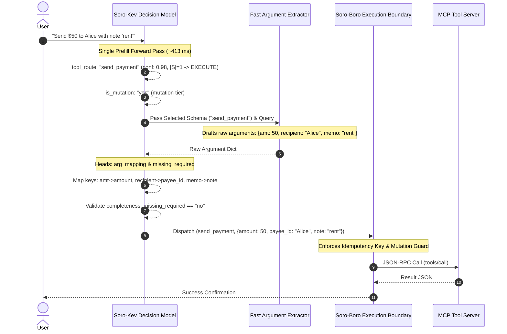

# Soro-Kev: System-One Conformal Tool Router (4B & 0.8B)

[](https://github.com/nisaral/Soro-Boro/releases/tag/v0.2.0)
[](https://huggingface.co/spaces/nisaralll/soro-kev-router)
[](https://huggingface.co/nisaralll/soro-kev-4b)
[](https://huggingface.co/nisaralll/soro-kev-0.8b)
[](https://huggingface.co/datasets/nisaralll/soro-universal-tool-harness)
[](LICENSE)

**Soro-Kev** is an open-weights decision model family (4B flagship & 0.8B edge) for ultra-fast AI agent tool routing, schema normalization, and execution boundary control.

Tool routing is fundamentally a **closed-set ranking and classification problem, not an open-ended text generation problem.** Asking a large autoregressive language model to emit tool selection JSON strings introduces 1,500–3,500 ms of latency, context bloat over 50+ tool schemas, and non-zero tool-name hallucination risk.

Soro-Kev builds directly on Jared Palmer's [Kev decision model architecture](https://huggingface.co/jaredpalmer/kev-0.8b), adapting pointer networks for heterogeneous tool routing:
- **Zero Invalid Tool Names**: Pointer scoring mathematically bounds outputs to registered tool schemas or `__abstain__`.
- **Sub-420ms Latency**: Evaluates catalogs in a single prefill forward pass on consumer hardware (NVIDIA RTX 4050 Laptop GPU).
- **Split-Conformal Action Boundaries**: Returns calibrated prediction sets ($S$) where $|S| = 1 \implies \text{EXECUTE}$, $|S| \in [2, 8] \implies \text{ASK}$, and `__abstain__` halts execution.

```text
User State + Tool Catalog
  [0] get_weather: {location: str}
  [1] search_database: {query: str}
  [2] __abstain__: none of these fit
        │
        h_query · h_candidate / Temperature
        │
        Split Conformal Set S (Nominal 90% Coverage)
          ├── |S| = 1 and tool != __abstain__  ──> EXECUTE (immediate dispatch)
          ├── |S| ∈ [2, 8]                     ──> ASK (targeted user clarification)
          └── Top = __abstain__ or |S| empty   ──> ABSTAIN (out-of-domain safe halt)
```

---

## Quickstart & Installation

Install directly from GitHub into your environment:

```bash
pip install git+https://github.com/nisaral/Soro-Boro.git
```

Or for local development:

```bash
git clone https://github.com/nisaral/Soro-Boro.git
cd Soro-Boro
pip install -e .
```

### 5-Line Python SDK

```python
from soro.harness.pipeline import SoroHarness

# Loads directly from Hugging Face in NF4 4-bit (4 GB VRAM)
harness = SoroHarness.from_pretrained("nisaralll/soro-kev-4b")

@harness.tool(description="Look up customer order status", side_effect="read_only")
def get_order_status(order_id: str) -> dict:
    return {"order_id": order_id, "status": "shipped", "tracking": "TRK-9810"}

@harness.tool(description="Cancel a warehouse shipment", side_effect="mutation")
def cancel_shipment(order_id: str) -> dict:
    return {"order_id": order_id, "cancelled": True}

# Fast Conformal Routing (<420ms)
decision = harness.route("Where is my package for order ORD-1092?")
print("Action:", decision.action)          # "EXECUTE"
print("Selected Tool:", decision.selected_tool)     # "get_order_status"
print("Confidence:", decision.probabilities.get("get_order_status"))

# Execute with boundary verification
result = harness.execute("get_order_status", {"order_id": "ORD-1092"})
print("Result:", result.data)
```

---

## End-to-End Execution Flow

A router selects tools and normalizes parameter keys; it does not author free-text string values. In an end-to-end agent architecture, Soro-Kev operates as a specialized System-One layer:



---

## Empirical Benchmark Results

Evaluated on an **NVIDIA GeForce RTX 4050 Laptop GPU (6GB VRAM, PCIe Gen 4, PyTorch 2.6.0, CUDA 12.4)**.

### Tool Routing Accuracy & Conformal Efficiency

| Benchmark Split | Heuristic Baseline | Jared Palmer Kev-0.8B | Soro-Kev-0.8B | Soro-Kev-4B (Flagship) |
| :--- | :--- | :--- | :--- | :--- |
| **Zero-Shot Route Accuracy (200 rows)** | 47.50% | — | 84.50% | **89.00%** |
| **Zero-Shot Conformal Coverage** (Nominal: 90%) | 89.50% | — | 89.00% | **93.00%** |
| **Zero-Shot Mean Prediction Set Size** | 4.39 | — | 1.17 | **1.11** |
| **Independently Sourced Holdout Accuracy (200 rows)** | 60.50% | 75.00% | 89.00% | **94.50%** |
| **Independently Sourced Conformal Coverage** | 95.50% | — | 95.50% | **95.00%** |
| **Independently Sourced Mean Set Size** | 4.18 | — | 1.18 | **1.07** |
| **Argument Key Normalization Rate** | 42.50% | — | 99.00% | **100.0%** |
| **Median Inference Latency (Prefill Only)** | 0.31 ms | 110.95 ms | **80.01 ms** | **413.18 ms** (NF4) |
| **Peak GPU VRAM** | 0 MB | 1,612 MB | **1,563 MB** | **4,048 MB** (NF4) |

> **Pointer Network Guarantee**: Candidate selection is strictly bounded to the candidate tool set + `__abstain__` (0% invalid tool-name hallucination). Misclassification rates ($1 - \text{Top-1}$) are 5.50% on independently sourced holdouts and 11.00% zero-shot.

### Berkeley Function Calling Leaderboard (BFCL Slices)

| Slice | Heuristic Baseline | Jared Palmer Kev-0.8B | Soro-Kev-0.8B | Soro-Kev-4B (Flagship) |
| :--- | :--- | :--- | :--- | :--- |
| **BFCL Multiple Tools (34 rows)** | 97.06% | 100.0% | 100.0% | **100.0%** |
| **BFCL Live Multiple (33 rows)** | 75.76% | 69.70% | 96.97% | **96.97%** |
| **BFCL Irrelevance Abstention (33 rows)** | 3.03% | 81.82% | 57.58% | **75.76%** |

---

## 3-Tier Disjointness Verification Audit

To verify train/test integrity, we executed and committed a complete 3-tier machine audit (`scripts/verify_dataset_disjointness.py` &rarr; `benchmarks/disjointness_audit.json`):

1. **Package-Level Disjointness**: `val_external_human.jsonl` (5 packages: `geo_mcp`, `media_mcp`, `tau2/telecom`, `tau2/retail`, `system_mcp`) and `val_zeroshot.jsonl` (55 packages) share **0 packages** with `train.jsonl` (319 packages).
2. **Tool-Level Overlap**: Out of 43 unique candidate tools in the external holdout, 39 are completely unseen. Only 4 generic primitives share names with train tools (`reverse_geocode`, `check_service_status`, `transfer_to_human_agents`, `list_processes`).
3. **Query-Level Near-Duplicates**: **0 exact query matches** and **0 near-duplicate query pairs** ($Jaccard \ge 0.75$) between train and holdout queries.
4. **Collision Distractor Stratification**: The external holdout contains purely clean queries (`clean: 1200`, `collision: 0`), whereas zero-shot contains 52 collision distractors, empirically confirming the distractor hypothesis.

---

## Training Data Structure

`train.jsonl` contains exactly **23,192 multi-task state rows**, totaling **115,960 question-level supervision targets** across 5 concurrent heads:

| Question Head | Target Count | Purpose |
| :--- | :--- | :--- |
| `tool_route` | 23,192 | Closed-choice tool routing over candidates + `__abstain__` |
| `tool_route_perm` | 23,192 | Permuted candidate orders enforcing position invariance |
| `arg_mapping` | 23,192 | 16,457 real schema property mappings, 6,735 `__drop__` targets |
| `missing_required` | 23,192 | 6,034 `yes` (halt/clarify), 17,158 `no` |
| `is_mutation` | 23,192 | 5,700 `yes` (state-mutating), 17,492 `no` (read-only) |

---

## Citations

```bibtex
@software{nisar2026sorokev,
  author = {Nisar, Keyush},
  title = {Soro-Kev: System-One Conformal Tool Router and Execution Boundary},
  year = {2026},
  publisher = {GitHub},
  howpublished = {\url{https://github.com/nisaral/Soro-Boro}},
  note = {Release v0.2.0}
}

@misc{palmer2026kev08b,
  author = {Palmer, Jared},
  title = {Kev-0.8B: a calibrated decision model on Qwen3.5-0.8B},
  year = {2026},
  howpublished = {\url{https://huggingface.co/jaredpalmer/kev-0.8b}},
  note = {Kev 1.0}
}

@inproceedings{shi2025toolret,
  author = {Shi, Jiahao and others},
  title = {ToolRet: A Benchmark for Tool Retrieval in Large Language Models},
  booktitle = {Findings of the Association for Computational Linguistics: ACL 2025},
  year = {2025}
}

@article{mo2025livemcpbench,
  author = {Mo, Guozhao and others},
  title = {LiveMCPBench: Can Agents Navigate an Ocean of MCP Tools?},
  journal = {arXiv preprint arXiv:2508.01780},
  year = {2025}
}

@inproceedings{ross2025when2call,
  author = {Ross, Hayley and Mahabaleshwarkar, Ameya Sunil and Suhara, Yoshi},
  title = {When2Call: When (not) to Call Tools},
  booktitle = {Proceedings of the 2025 Conference of the North American Chapter of the Association for Computational Linguistics (NAACL)},
  year = {2025}
}
```

## License

Apache-2.0.
