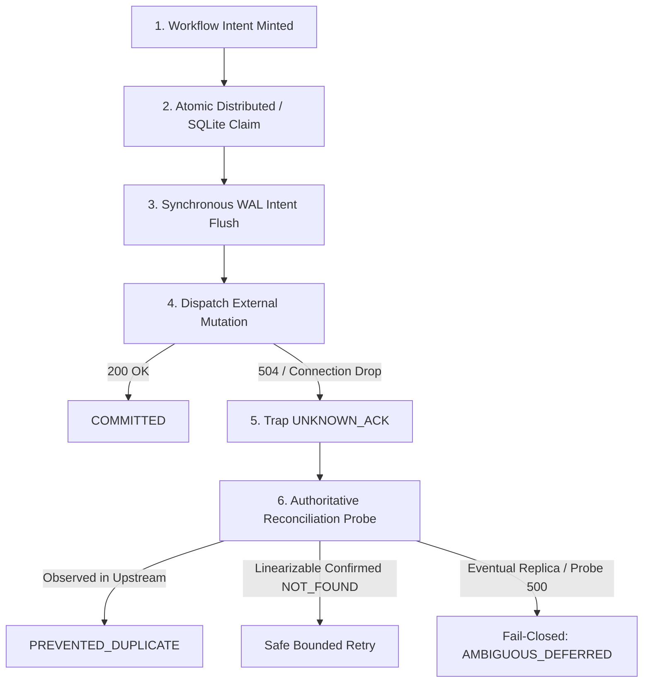

# Soro-Boro

> **Find which agent tools are unsafe to retry, then make them safe.**

[](https://opensource.org/licenses/Apache-2.0)
[](https://www.python.org/downloads/)
[](https://github.com/nisaral/Veyra/actions)

Soro-Boro is execution-boundary middleware for autonomous AI agents. It consists of two unified components:
1. **The Audit Layer (`soro-audit`)**: Scans MCP server tool manifests and execution traces to find which tools lack idempotency keys, hide non-idempotent side effects, or cause confirmation fatigue.
2. **The Execution Boundary SDK (`soro_boro`)**: Wraps consequential mutations to prevent duplicate side effects on network drops, manages atomic cross-process claims, and fails closed to explicit ambiguous outcomes (`AMBIGUOUS_DEFERRED`) when upstream state cannot be confirmed.

---

## The Problem

Autonomous agents frequently call tools that perform consequential real-world side effects (charging cards, creating tickets, mutating databases, dispatching webhooks). When a network timeout or connection reset occurs:

```text
Agent / Host                      External API / Service
    │                                       │
    │──── POST /v1/mutations ──────────────>│ (Write COMMITTED to DB)
    │                                       │
    │< - - - 504 Timeout / Connection Drop -│ (ACK lost in transit)
    │                                       │
    ▼                                       ▼
Outcome UNKNOWN                     Side Effect Already Occurred!
```

1. **Native keys don't protect most APIs**: Stripe and AWS support native idempotency keys, but internal databases, SQL inserts, GitHub issues, Slack messages, and internal webhooks **do not**.
2. **Local receipt logging isn't enough**: Systems that log receipts locally on success (e.g. SafeAgent) still blind-retry when a network drop prevents receiving the receipt.
3. **Eventual consistency breaks naive verification**: Reading from read replicas right after a write often returns `NOT_FOUND`. Treating `NOT_FOUND` as authoritative permission to retry causes duplicate mutations.
4. **Idempotency keys expire**: Providers (like Stripe) prune keys after 24–48 hours. Blind re-dispatch of orphaned intents after an outage creates new duplicate writes.

---

## Architecture & Guarantees



### Technical Guarantees
- **Intent-Based Identity**: Keys are minted once per logical workflow intent (not hashed from token parameters, preventing intent conflation). Parameters are hashed to enforce contract consistency (`MismatchedParametersError`).
- **Atomic Pre-Dispatch Claim**: Cross-process `SQLiteClaimStore` with `BEGIN IMMEDIATE` prevents millisecond concurrency races between parallel agent actions.
- **Durable Write-Ahead Log**: Intent is synchronously flushed (`fsync`) before the socket connects. Startup scans segregate recoverable in-flight operations from expired orphans.
- **Fail-Closed on Eventual Consistency**: `NOT_FOUND` on read replicas is non-authoritative by default. If a provider cannot guarantee linearizable read-after-write, Soro-Boro returns `AMBIGUOUS_DEFERRED`.

---

## Benchmark: Non-Keyed Services Evaluation

Evaluated against a real SQLite database service lacking native API deduplication under 5 distributed systems failure modes:

| Failure Mode | Naive Retries | SafeAgent Baseline (Req-ID + Receipt) | Naive Verify-Before-Retry | Soro-Boro Execution Boundary |
|---|---|---|---|---|
| **Dropped ACK on Commit (504)** | 100% Duplicate Write | 100% Duplicate Write | 0% Duplicate *(strong read)* | **0% Duplicate Write** *(PREVENTED_DUPLICATE)* |
| **Eventual Replica Lag** | 100% Duplicate Write | 100% Duplicate Write | 100% Duplicate Write *(premature retry)* | **0% Duplicate Write** *(AMBIGUOUS_DEFERRED)* |
| **Reconciler Probe 500** | 100% Duplicate Write | 100% Duplicate Write | Crashes / Blind Retry | **0% Duplicate Write** *(AMBIGUOUS_DEFERRED)* |
| **Concurrency Race** | 100% Duplicate Writes | 100% Duplicate Writes | Race Condition / Duplicate | **0% Duplicate Write** *(Atomic claim blocks race)* |

---

## Quickstart

### 1. Install
```bash
pip install -e "./python[dev]"
```

### 2. Audit MCP Tools (`soro-audit`)
Run the standalone behavioral linter to find unsafe tools across any Model Context Protocol server:
```bash
# Static annotation and hint inspection
soro-audit --stdio "node dist/index.js" --dry-run

# Dynamic behavioral verification in an isolated sandbox
soro-audit --stdio "node dist/index.js" --markdown audit_summary.md
```

### 3. Wrap Consequential Tools (`soro_boro`)
Protect external writes using `@soro_wrap`:

```python
from soro_boro import (
    soro_wrap,
    SideEffectClass,
    OperationIdentity,
    ReconciliationResult,
    ProviderLifecycleState,
)

# Define reconciler for non-keyed service
def order_reconciler(op: OperationIdentity) -> ReconciliationResult:
    # Query upstream by op marker
    order = my_db.query_by_op_marker(op.operation_id)
    if order:
        return ReconciliationResult(
            state=ProviderLifecycleState.SUCCEEDED,
            authoritative=True,
            raw_response=order,
        )
    return ReconciliationResult(
        state=ProviderLifecycleState.NOT_FOUND,
        authoritative=False, # Eventual consistency by default!
        consistency_observed="eventual",
    )

@soro_wrap(
    side_effect_class=SideEffectClass.NON_IDEMPOTENT_MUTATION,
    reconciler=order_reconciler,
)
def create_order(customer_id: str, sku: str, amount: int, op: OperationIdentity | None = None):
    # Pass operation ID as marker to non-keyed service
    return my_db.insert_order(customer_id, sku, amount, client_op_marker=op.operation_id)

outcome = create_order("cust_101", "SKU-99", 5000)
if outcome.is_ambiguous:
    print(f"Halted safely: {outcome.status}")  # AMBIGUOUS_DEFERRED
else:
    print(f"Outcome: {outcome.status}")       # COMMITTED or PREVENTED_DUPLICATE
```

---

## Repository Structure

- `python/src/soro_boro/`: Core execution boundary SDK (identity, claims, WAL, lifecycle, interceptor).
- `python/src/soro/cli_audit.py`: `soro-audit` MCP server linter and behavioral verifier.
- `python/tests/`: Adversarial distributed systems test suites and non-keyed service benchmarks.
- `web/`: Next.js interactive architecture visualization and synthetic failure mode simulator.

---

## License

Apache-2.0. See [LICENSE](LICENSE) for details.
